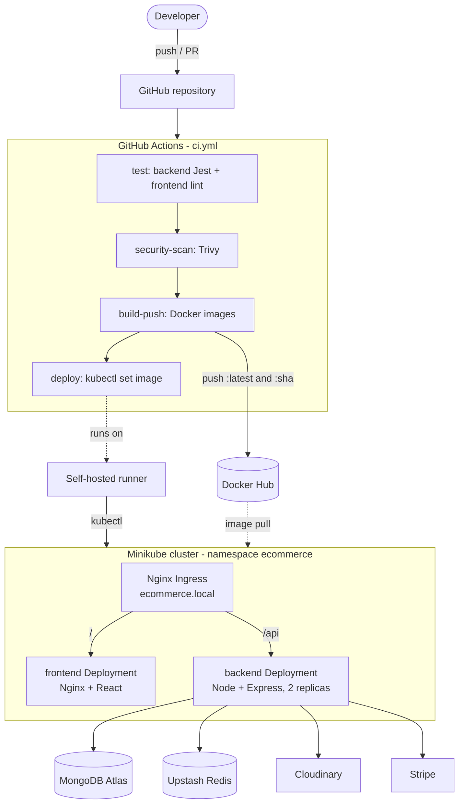

# ☁️ Nimbus Shop — DevOps Portfolio Project

**A MERN e-commerce app used as a realistic deployment target to practice a full DevOps workflow: containers, a CI/CD pipeline on GitHub Actions, and deployment to a local Kubernetes (Minikube) cluster.**


## 🎯 Scope

This repository is **not** about building shop features. The application code comes from an open-source project (see [Credits](#-about-the-app--credits)). What I built and maintain here is the infrastructure around it:

- 📦 **Containers** — multi-stage `Dockerfile`s for the frontend (Vite build served by Nginx with SPA fallback) and the backend, plus a `docker-compose.yml`.
- ☸️ **Kubernetes** — manifests for a local Minikube cluster: namespace, deployments, services, Nginx Ingress and secrets.
- 🔁 **CI/CD** — one GitHub Actions workflow: test → security scan → build & push images → deploy.
- 🛡️ **Deployment hygiene** — rolling updates with zero unavailable pods, readiness/liveness probes, and CPU/memory requests and limits.

> **Honest status:** this runs on a **local Minikube cluster**, deployed by a **self-hosted runner** on my machine. It is a lab environment, not a production system. See the [Roadmap](#-roadmap-not-implemented-yet) for what is deliberately missing.

---

## 🏗️ Architecture



### What happens on each Git event

| Event | test | security-scan | build-push | deploy |
|---|:-:|:-:|:-:|:-:|
| Pull request to `develop` / `main` | ✅ | ✅ | — | — |
| Push to `develop` | ✅ | ✅ | ✅ | — |
| Push / merge to `main` | ✅ | ✅ | ✅ | ✅ |

- Images are tagged `latest` and with the commit SHA; the deploy job rolls the cluster to the SHA tag.
- The Trivy scan is currently **report-only** (`exit-code: 0`); it does not fail the build.

---

## 🧰 Tech Stack

**Application:** React (Vite), Node.js + Express 5, MongoDB Atlas, Redis (Upstash), Cloudinary, Stripe

**Infrastructure & DevOps:** Docker, Docker Compose, Kubernetes (Minikube), Nginx Ingress, GitHub Actions, Trivy

---

## 🚀 Running It

### Prerequisites

- [Node.js](https://nodejs.org/) **20.19 or newer** (the backend uses Mongoose 9; CI and the images use Node 22)
- [Docker Desktop](https://www.docker.com/products/docker-desktop/)
- [Minikube](https://minikube.sigs.k8s.io/docs/start/) and [kubectl](https://kubernetes.io/docs/tasks/tools/)
- Accounts/keys for MongoDB Atlas, Upstash Redis, Cloudinary and Stripe (test mode)

### 1. Configure secrets

Create `backend/.env` (it is git-ignored):

```env
MONGO_URI=
UPSTASH_REDIS_URL=
ACCESS_TOKEN_SECRET=
REFRESH_TOKEN_SECRET=
CLOUDINARY_CLOUD_NAME=
CLOUDINARY_API_KEY=
CLOUDINARY_API_SECRET=
STRIPE_SECRET_KEY=
```

### 2a. Run with Docker Compose

```bash
cd docker
VITE_API_URL=http://localhost:5000/api docker compose up --build
# frontend: http://localhost:5173   backend: http://localhost:5000
```

### 2b. Run on Kubernetes (Minikube)

```bash
minikube start
minikube addons enable ingress

# generate k8s/secrets/secrets.yaml (git-ignored) from backend/.env
cd k8s/secrets && bash generate-secrets.sh && cd ../..

# apply in this order (do NOT apply the whole k8s/ folder: secret-template.yaml is only an example)
kubectl apply -f k8s/namespace.yaml
kubectl apply -f k8s/secrets/secrets.yaml
kubectl apply -f k8s/backend -f k8s/frontend -f k8s/ingress

kubectl get pods -n ecommerce
```

Add `127.0.0.1 ecommerce.local` to your hosts file (`C:\Windows\System32\drivers\etc\hosts` on Windows), run `minikube tunnel` if you use the Docker driver, then open <http://ecommerce.local>.

> The backend runs with `NODE_ENV=development` on purpose: in `production` the auth cookies get the `Secure` flag and would not be sent over the plain-HTTP ingress. Move to `production` together with TLS.

### 3. Enable the pipeline

Repository secrets used by `.github/workflows/ci.yml`:

| Secret | Purpose |
|---|---|
| `DOCKERHUB_USERNAME`, `DOCKERHUB_TOKEN` | log in and push images |
| `KUBECONFIG_DATA` | base64 kubeconfig used by the deploy job |

The deploy job needs a self-hosted runner labeled `minikube` that can reach the cluster.

---

## 🔧 Engineering Notes

The pipeline was inherited in a broken state (every run on `develop` was red). Root causes found and fixed:

| Symptom | Root cause | Fix |
|---|---|---|
| Backend test suite failed before running | `lib/stripe.js` throws on import when `STRIPE_SECRET_KEY` is missing | dummy test key in the CI step |
| `jest` never exited (job could hang until the 6 h limit) | `ioredis` opened a connection at import time and retried forever | `lazyConnect: true` + job `timeout-minutes` |
| Dependency/engine mismatch | Node 18 in CI and images, but Mongoose 9 / MongoDB driver 7 need Node ≥ 20.19 | Node 22 everywhere |
| Backend crashed at start with `NODE_ENV=production` | `app.get("*")` is invalid in Express 5 (path-to-regexp v8) | `"/{*splat}"` |
| CD never ran | `workflow_run` only fires for workflow files on the *default* branch | deploy merged into `ci.yml` as a job |
| Supply-chain risk | `trivy-action@master` floated | pinned to a commit SHA |

---

## 🗺️ Roadmap (not implemented yet)

These are ideas, **not** features of this repository today:

- [ ] More tests (auth, cart, checkout) — currently only a health check and a 404 test
- [ ] Horizontal Pod Autoscaler (needs metrics-server)
- [ ] Prometheus + Grafana, and a log store (Loki/ELK)
- [ ] Public exposure without a VPS (e.g. Cloudflare Tunnel) and TLS on the ingress
- [ ] Fail the pipeline on high/critical Trivy findings
- [ ] Immutable image tags in the manifests instead of `latest`

---

## 🔖 About the App & Credits

The application layer (UI, authentication, cart, Stripe checkout, etc.) is built on the open-source **[mern-ecommerce](https://github.com/burakorkmez/mern-ecommerce)** project by [Burak Orkmez](https://github.com/burakorkmez), released under the MIT license. I did not rewrite the application logic; I used it as a realistic deployment target. The original README is kept in [`README-original.md`](./README-original.md).

## 📜 License

MIT, following the license of the original base application. See [LICENSE](./LICENSE).

## 📬 Contact

Built by **Alfan Huda** as part of a DevOps & Cloud Engineering portfolio.

- GitHub: [@alternatif-omg](https://github.com/alternatif-omg)
